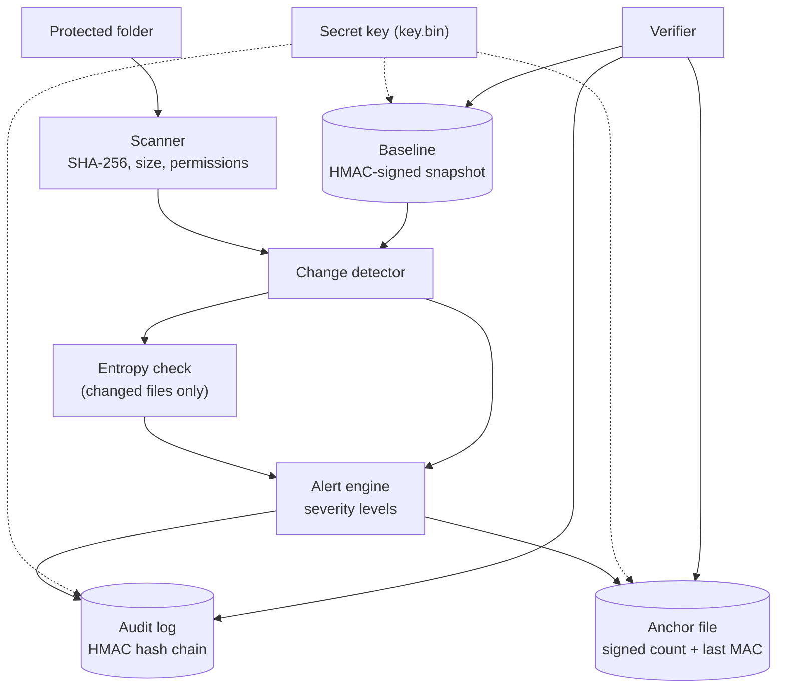
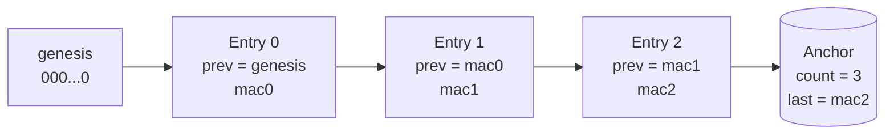

# TamperGuard: Architecture Documentation

**TamperGuard: File Integrity Monitoring with Tamper-Evident Logging**
CS3002 Information Security (Fall 2026), Term Project
Author: Muhammad Ahmad (GitHub: MuhammadAhmad59)

## 1. Purpose

When an attacker breaks into a system they usually do two things: they change files (plant a web
shell, edit a configuration, encrypt data) and then they try to hide it by editing the logs.
TamperGuard defends against both. It detects unauthorized changes to a protected folder, and it
stores its alerts in an audit log in which any edit, deletion or truncation can be detected.

Use case: protecting a single folder on one machine, such as a web server directory, a
configuration folder or a set of backups.

## 2. System overview



The key is used to sign three things: the baseline, every log entry and the anchor. The verifier
re-checks all three on every run, so an attacker cannot change the evidence without the key.

## 3. Components

| Component | Where | What it does |
|---|---|---|
| Scanner | `scan()`, `hash_file()` | Walks the folder and records SHA-256 hash (read in 1 MB blocks), size and permission mode of every regular file. Symbolic links are skipped. |
| Baseline store | `save_baseline()`, `load_baseline()` | Saves the trusted snapshot in `baseline.json` with an HMAC-SHA256 over its contents. Written to a temporary file first and then renamed, so a crash cannot leave a half-written baseline. |
| Change detector | `build_events()` | Compares the current scan with the baseline and produces events: MODIFIED, DELETED, NEW_FILE, RENAMED (same content, new name), PERMISSION_CHANGED and MASS_CHANGE. |
| Entropy check | `shannon_entropy()`, `file_entropy()` | For files whose hash changed, measures how random the content looks (see section 6). Produces ENCRYPTION_SUSPECTED and RANSOMWARE_SUSPECTED. |
| Alert engine | `format_alert()`, `SEVERITY` | Prints each event with a severity (INFO, MEDIUM, HIGH, CRITICAL) and colours. In watch mode each distinct change is reported only once. |
| Secure log | `SecureLog` | Appends each event to `audit.log` as one JSON line, chained and signed (see section 5). |
| Anchor | `audit.anchor` | A small signed file holding the number of log entries and the MAC of the last one. Detects truncation and deletion of the log. |
| Secret key | `key.bin` | 32 random bytes from `secrets.token_bytes`, created by `init`. Should be copied to offline storage. |
| CLI | `main()` | Commands: `init`, `check`, `watch`, `rebaseline`, `verify-log`, `show-log`. |

## 4. Data stored on disk (folder `tg_data`)

| File | Content |
|---|---|
| `key.bin` | Secret key (never commit this to Git) |
| `baseline.json` | Root path, creation time, and for each file: `sha256`, `size`, `mode`, `entropy`, plus the `mac` |
| `audit.log` | One JSON entry per line (format below) |
| `audit.anchor` | `count`, `last_mac`, `mac` |

Format of one log entry:

```json
{
  "idx": 3,
  "ts": "2026-11-19T12:19:21.993+00:00",
  "event": "NEW_FILE",
  "severity": "MEDIUM",
  "path": "shell.php",
  "details": {"sha256": "...", "size": 28},
  "prev": "<MAC of entry 2>",
  "mac": "<HMAC-SHA256 of all the fields above>"
}
```

## 5. Tamper-evident log design



Each entry contains the MAC of the previous entry (`prev`) and its own MAC, computed with the
secret key. The anchor records how many entries exist and the last MAC.

| Attack on the log | How it is detected |
|---|---|
| Edit an entry | Its MAC no longer matches its content |
| Delete an entry from the middle | The `prev` link and the index sequence break |
| Re-order entries | The index and `prev` links break |
| Remove the newest entries (truncate) | Anchor count does not match the number of entries |
| Delete the whole log | The anchor says entries should exist, or the log is missing while a baseline exists |
| Rewrite the whole log with a recomputed plain SHA-256 chain | The attacker cannot produce valid MACs without the key |
| Forge the anchor | The anchor has its own MAC |

**Why HMAC and not a plain hash chain:** anyone can recompute a plain SHA-256 chain after editing
an entry. A keyed MAC cannot be recomputed without the secret key. Scenario S13 in the test suite
demonstrates this.

**Why the anchor is needed:** a chain alone cannot show that its *end* was cut off. The signed
anchor closes this gap (scenarios S11, S12 and S16).

## 6. Entropy-based ransomware detection

Encrypted data looks random. Shannon entropy measures this on a scale of 0 to 8 bits per byte:
ordinary text is about 4 to 5, encrypted or compressed data is above 7.5.

1. When the baseline is created, the entropy of the first 64 KB of each file is stored.
2. When a file's hash changes, its new entropy is measured.
3. If the old entropy was below 7.0 and the new entropy is 7.5 or above, the file raises
   ENCRYPTION_SUSPECTED.
4. If 3 or more files do this, RANSOMWARE_SUSPECTED (CRITICAL) is raised.

This catches ransomware that encrypts only a few files and therefore stays below the MASS_CHANGE
threshold (10 modified or deleted files). Design choices that avoid false alarms:

- Files smaller than 1 KB are skipped, because they cannot reach high entropy.
- Files that were already high-entropy (zip, jpg, mp4) are ignored.
- Entropy is measured only for files that changed, so a normal check is not slowed down.

The thresholds can be changed with `--entropy-threshold` and `--ransom-files`.

## 7. Threat model

**Assets:** the files in the protected folder, the baseline, the audit log.

**Attacker:** can read and write the protected folder and the `tg_data` folder with normal file
permissions, but does not know the secret key.

**Out of scope:** an attacker who steals the key, who stops the TamperGuard process, or who
restores an older valid copy of the log (see the Limitations section of the security analysis).

## 8. Design decisions

| Decision | Reason |
|---|---|
| Python standard library only | Nothing to install, runs on Windows and Linux |
| Polling (periodic re-scan) instead of operating-system notifications | Portable and simple; the cost is a detection delay of about the polling interval |
| Content hashes instead of timestamps | An attacker can forge size and modification time (scenario S03) but not a SHA-256 hash |
| Constant-time MAC comparison (`hmac.compare_digest`) | Avoids timing leaks |
| `rebaseline` refuses to run if the log is not intact | Prevents accepting a tampered state as the new trusted one |
| Exit codes 0 / 1 / 2 | 0 = clean, 1 = changes found, 2 = baseline or log tampered, so the tool can be used in scripts |

## 9. Repository layout

```
ISProject/
  tamperguard.py          the tool (library and command line)
  attack_simulation.py    21 test scenarios, benchmark and latency test
  demo.py                 scripted demo for the in-class evaluation
  results.json, results.md  output of the last evaluation run on Windows
  README.md               how to run
  docs/                   proposal, architecture, security analysis
```

## 10. How to run

See `README.md`. In short:

```
python tamperguard.py init <folder>
python tamperguard.py check <folder>
python tamperguard.py watch <folder>
python tamperguard.py verify-log
python attack_simulation.py
python demo.py
```
